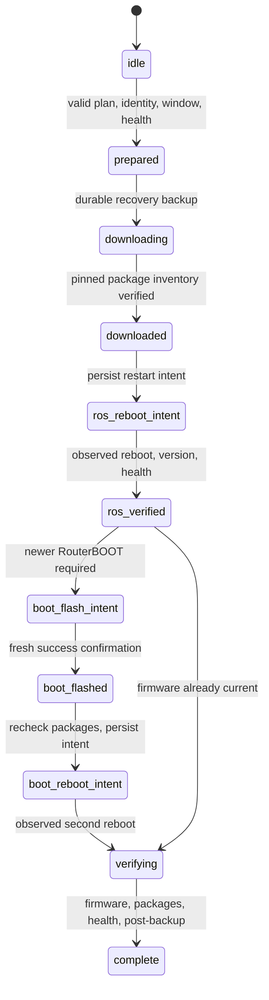

# Update state and failure handling

Failures after a transaction starts can lead to attention. Insufficient
maintenance time defers the next mutation while preserving its stage.
Firmware-only updates skip package download and the first restart.

Plans bind configuration, identity, architecture, packages and versions.
Transactions additionally bind the backup credential's identifier.
State writes use atomic replacement and fsync; new backup directory entries and
ancestors are flushed before cleanup. Device locks coordinate matching serial
numbers within one data directory. Separate controllers need external coordination.

Restart verification compares uptime with a conservative elapsed-time lower
bound, measured before the next snapshot request. A delayed reply cannot itself
prove a restart. Monotonic clocks are compared only within the same Linux boot;
after a controller reboot, a strict saved-uptime reduction is required.

No atomic transaction spans the controller disk, SSH and router flash. A crash
between intent and command is ambiguous. Flash/restart are never blindly
repeated; unclear downloads are only observed. Existing NPK files can be applied
by an independent reboot or power loss. Deferred/failed states need monitoring.

The vendor's version offer can change between check and download. Metadata and
filenames are rechecked before restarting, but the remote offer is not atomic.
RouterOS validates and installs signed NPK content; filenames do not substitute
for cryptographic content validation.

## Trust boundary

The local administrator, service account, private state directory, pinned device
identity and vendor update machinery are trusted. A compromised router or
controller can falsify data; this service is not an integrity scanner.

Paramiko uses an explicit key and RejectPolicy without host-key enrollment,
agent fallback or legacy-crypto fallback. Commands use nonce-based success/error
markers because SSH exit status is insufficient; their effects are then verified.
Health checks do not execute arbitrary shell commands. Raw responses and
third-party exception details are excluded from application errors.

## Integration checklist

1. Verify supported RouterOS, HTTPS/certificate settings and account capabilities.
2. Independently verify the host key, serial, architecture and optional model.
3. Validate package available/disabled/scheduled fields and updater statuses.
4. Create, retrieve and restore an encrypted backup on test equipment.
5. Exercise a full RouterOS/RouterBOOT cycle, including noninteractive flash and
   fresh success-log verification, on a test RouterBOARD.
6. Test controller interruptions, timeouts and network recovery.
7. Test systemd sandboxing, credentials and the manual helper on the target Linux.
8. Verify actual router forwarding, Internet access and inbound VPN externally.

Hardware and live systemd validation are not implied by simulated-device tests.
